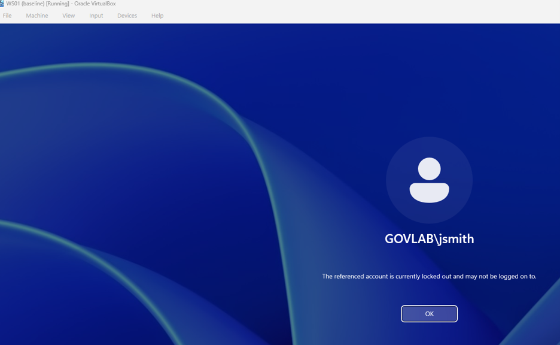
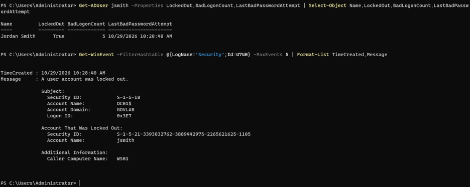
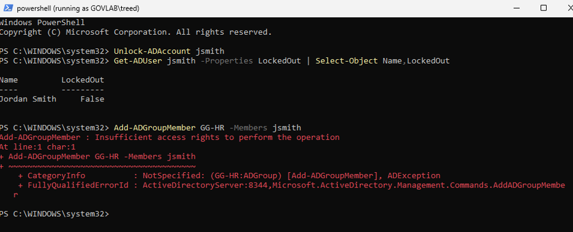

# Scenario 1: Account lockout

**Lab:** corp.govlab.internal · DC01 (Windows Server 2025 DC) · WS01 (Windows 11 Enterprise)
**User:** Jordan Smith (`GOVLAB\jsmith`), Finance
**Ticket type:** Account locked out · P2

## Broken state
- Set a domain lockout policy on DC01: 5 bad attempts, 15-minute lockout, 15-minute observation window.
- On WS01, signed in as `GOVLAB\jsmith` with a wrong password 5 times.

```powershell
# On DC01
Set-ADDefaultDomainPasswordPolicy -Identity corp.govlab.internal -LockoutThreshold 5 -LockoutDuration 00:15:00 -LockoutObservationWindow 00:15:00
```

## Symptom
WS01 sign-in screen: **"The referenced account is currently locked out and may not be logged on to."**



## Diagnosis
Checked the account and the lockout event on the domain controller, not the workstation.

```powershell
# On DC01
Search-ADAccount -LockedOut
Get-ADUser jsmith -Properties LockedOut,BadLogonCount,LastBadPasswordAttempt |
  Select-Object Name,LockedOut,BadLogonCount,LastBadPasswordAttempt
Get-WinEvent -FilterHashtable @{LogName='Security';Id=4740} -MaxEvents 5 |
  Format-List TimeCreated,Message
```

Key output:
- `LockedOut : True`, `BadLogonCount : 5`
- Event **4740** (*A user account was locked out*), Account Name `jsmith`, **Caller Computer Name: WS01**, which tells you where the bad attempts came from



## Root cause
Five failed sign-ins inside the observation window hit the domain lockout threshold.

## Fix
**As Domain Admin (on DC01):**

```powershell
Unlock-ADAccount jsmith
Get-ADUser jsmith -Properties LockedOut | Select-Object Name,LockedOut
```

**As Tier 1 (stretch):** proved the Help Desk delegation works. From WS01, using RSAT and `runas` as `GOVLAB\treed` (member of GG-HelpDesk):

```powershell
# On WS01, as wsadmin (admin)
Add-WindowsCapability -Online -Name Rsat.ActiveDirectory.DS-LDS.Tools~~~~0.0.1.0
runas /user:GOVLAB\treed powershell

# In the window running as treed
Unlock-ADAccount jsmith
Get-ADUser jsmith -Properties LockedOut | Select-Object Name,LockedOut
Add-ADGroupMember GG-HR -Members jsmith   # expected to FAIL
```



## Verification
- `LockedOut : False` after the unlock.
- jsmith signed in on WS01 with the correct password.
- As treed, the unlock succeeded but `Add-ADGroupMember` failed with **Insufficient access rights**, which proves Tier 1 has unlock rights only, not group management (least privilege).

## Prevention
- If lockouts repeat, use event 4740's Caller Computer Name to find the source (often a stale saved credential, phone or mapped drive) instead of just unlocking again.
- Point users to self-service password change so they don't guess.

## Lesson learned
My first sign-in with the **correct** password succeeded even though DC01 showed `LockedOut : True`. WS01 let jsmith in on **cached credentials**. After signing out and trying again, the sign-in was refused as locked out. Always confirm lockout status on the domain controller (`Search-ADAccount -LockedOut`, event 4740) rather than trusting what a workstation shows.
