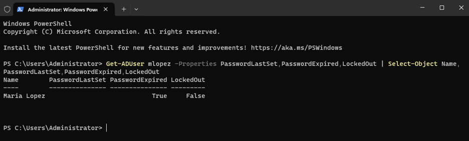
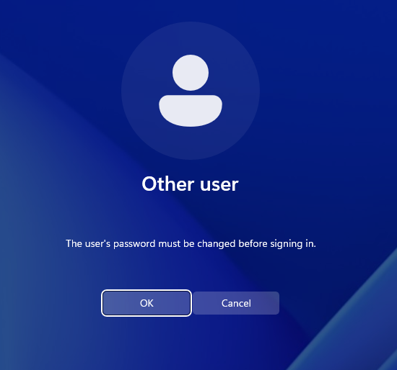

# Scenario 2: Forgotten password

**Lab:** corp.govlab.internal · DC01 (Windows Server 2025 DC) · WS01 (Windows 11 Enterprise)
**User:** Maria Lopez (`GOVLAB\mlopez`), HR
**Ticket type:** Reset my password · P3

## Broken state
Nothing broken technically. The user called saying she forgot her password. This scenario is about the **process**.

## Symptom
User can't sign in and doesn't know her current password.

## Diagnosis
**Identity verification first:** before touching the account, verify the caller is really Maria, either with a callback to the phone number on file or with confirmation from her manager. The method used is recorded in the ticket.

Then checked the account state on DC01:

```powershell
# On DC01
Get-ADUser mlopez -Properties PasswordLastSet,PasswordExpired,LockedOut |
  Select-Object Name,PasswordLastSet,PasswordExpired,LockedOut
```

The account was enabled and not locked out, so this was a plain forgotten password, not a lockout.



## Root cause
User forgot her password. No account or system fault.

## Fix
Set a temporary password and forced a change at next sign-in:

```powershell
# On DC01
Set-ADAccountPassword mlopez -Reset -NewPassword (Read-Host -AsSecureString "Temporary password")
Set-ADUser mlopez -ChangePasswordAtLogon $true
```

The temporary password is given to the user by phone, never by email or in the ticket.

## Verification
On WS01, signed in as `GOVLAB\mlopez` with the temporary password. Windows required a new password before completing sign-in.



## Prevention
- Offer self-service password reset so users can recover without a ticket.
- Remind users they can change their own password with Ctrl+Alt+Delete → Change a password.

## Lesson learned
The technical fix is two commands. The part that matters is **verifying identity before the reset**, because a password reset for the wrong caller is a security incident. Forcing a change at next sign-in means the help desk never knows the user's real password.
