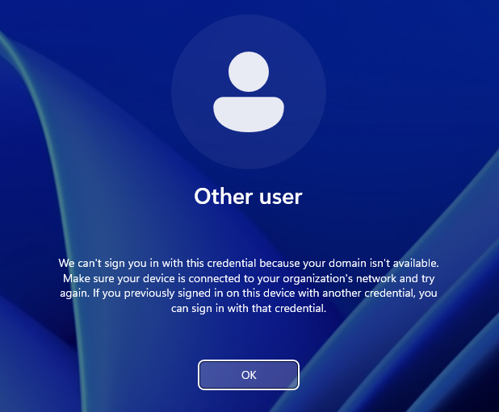
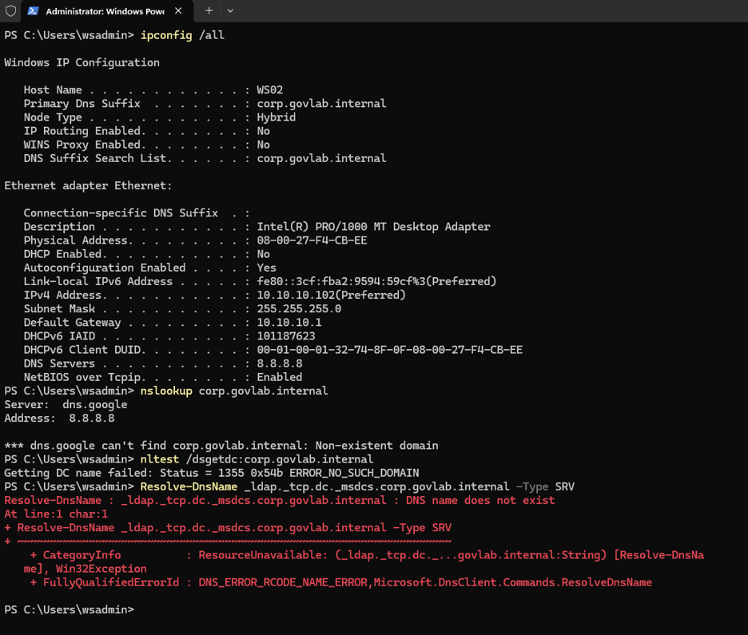
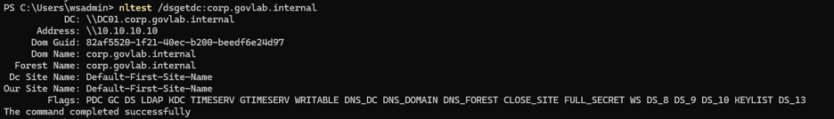

# Scenario 3: Wrong DNS server on a workstation

**Lab:** corp.govlab.internal · DC01 (Windows Server 2025 DC, DNS 10.10.10.10) · WS02 (Windows 11 Enterprise, 10.10.10.102)
**User:** Derek Chan (`GOVLAB\dchan`), Finance, who had never signed in on WS02, so no cached credentials
**Ticket type:** Network or DNS problem · P2

## Broken state
WS02's DNS server was changed from DC01 (10.10.10.10) to a public resolver (8.8.8.8).

```powershell
# On WS02 (local admin)
Set-DnsClientServerAddress -InterfaceAlias "Ethernet" -ServerAddresses 8.8.8.8
ipconfig /flushdns
Restart-Computer
```

## Symptom
Signing in as `GOVLAB\dchan` on WS02 failed with:
**"We can't sign you in with this credential because your domain isn't available."**
(Older Windows versions word this as "There are currently no logon servers available to service the logon request.")



## Diagnosis
Signed in with the local admin account (`.\wsadmin`), which doesn't need the domain:

```powershell
# On WS02
ipconfig /all
nslookup corp.govlab.internal
nltest /dsgetdc:corp.govlab.internal
Resolve-DnsName _ldap._tcp.dc._msdcs.corp.govlab.internal -Type SRV
```

| Check | Result | Meaning |
| --- | --- | --- |
| `ipconfig /all` | DNS Servers: **8.8.8.8** | Pointing at the wrong DNS server |
| `nslookup` | Domain not found | Public DNS doesn't know corp.govlab.internal |
| `nltest /dsgetdc:` | Error, no DC found | The workstation can't locate a domain controller |
| SRV lookup | Name does not exist | **Key test:** clients find DCs through this record |



## Root cause
Domain clients locate domain controllers through SRV records that only AD-integrated DNS (DC01) can answer. With DNS pointed at 8.8.8.8, WS02 couldn't find any DC, so domain sign-ins failed even though the network itself was fine.

## Fix

```powershell
# On WS02
Set-DnsClientServerAddress -InterfaceAlias "Ethernet" -ServerAddresses 10.10.10.10
ipconfig /flushdns
nltest /dsgetdc:corp.govlab.internal
```

## Verification
- `nltest /dsgetdc:` returned `\\DC01.corp.govlab.internal` and "The command completed successfully."
- `GOVLAB\dchan` signed in on WS02.



## Prevention
- Assign domain DNS servers through DHCP or Group Policy rather than by hand.
- Restrict who can change network settings on workstations.

## Lesson learned
The break didn't show up right away. The first sign-in attempt after changing DNS reached DC01 anyway ("password must be changed"), because Windows had **cached the DC's location**. The symptom appeared only after flushing DNS and restarting. I cancelled that first prompt instead of changing the password, because changing it would have cached dchan's credentials and hidden the failure.
