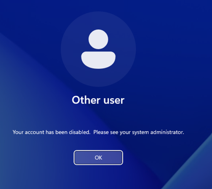
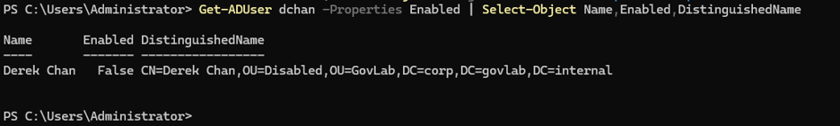
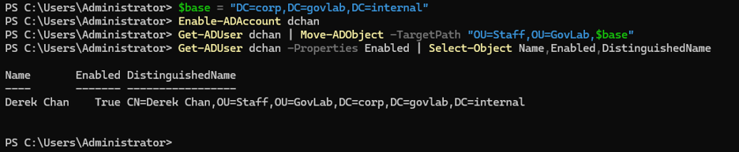

# Scenario 4: Offboarding and a disabled account

**Lab:** corp.govlab.internal · DC01 (Windows Server 2025 DC) · WS01 (Windows 11 Enterprise)
**User:** Derek Chan (`GOVLAB\dchan`), Finance
**Ticket types:** Offboard a user (leaver) → Offboard a user (rehire) · P3

## Broken state
HR requested Derek's access be removed on his last day. Offboarded the account the standard way: disable it, then move it to the Disabled OU.

```powershell
# On DC01
$base = "DC=corp,DC=govlab,DC=internal"
Disable-ADAccount dchan
Get-ADUser dchan | Move-ADObject -TargetPath "OU=Disabled,OU=GovLab,$base"
```

## Symptom
Signing in on WS01 as `GOVLAB\dchan`: **"Your account has been disabled. Please see your system administrator."**



## Diagnosis

```powershell
# On DC01
Get-ADUser dchan -Properties Enabled | Select-Object Name,Enabled,DistinguishedName
```

Output showed `Enabled : False`, with the DistinguishedName in `OU=Disabled,OU=GovLab`.



## Root cause
Intended: the account was offboarded. Later, HR reported Derek was being rehired, which needed the reverse.

## Fix (rehire)

```powershell
# On DC01
$base = "DC=corp,DC=govlab,DC=internal"
Enable-ADAccount dchan
Get-ADUser dchan | Move-ADObject -TargetPath "OU=Staff,OU=GovLab,$base"
Get-ADUser dchan -Properties Enabled | Select-Object Name,Enabled,DistinguishedName
```

## Verification
- `Enabled : True`, DistinguishedName back in `OU=Staff,OU=GovLab`.
- dchan signed in on WS01.



## Prevention
- Offboard on the date HR gives, not before, and record the request in the ticket.
- Use a consistent leaver process: disable, move to the Disabled OU, and review group memberships. Delete only after the retention period.

## Lesson learned
Disabling instead of deleting keeps the account's history, SID and group memberships for audit, so a rehire is a two-command fix instead of rebuilding access from scratch. Moving leavers to a dedicated OU makes them easy to audit and keeps them out of active-user policies.
