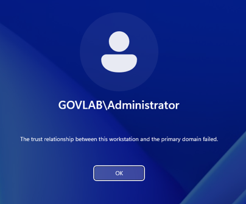
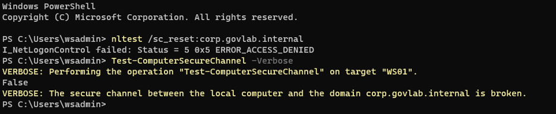
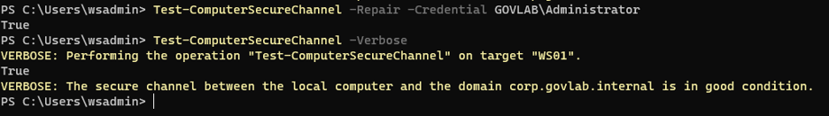

# Scenario 5: Broken trust relationship

**Lab:** corp.govlab.internal · DC01 (Windows Server 2025 DC) · WS01 (Windows 11 Enterprise)
**Test account:** `GOVLAB\Administrator`
**Ticket type:** Workstation problem · P2

## Broken state
WS01's computer-account password was reset on the domain side, so it no longer matched the password WS01 holds. This is the same mismatch you get when a VM or PC is restored from an old snapshot or backup.

```powershell
# On DC01
Get-ADComputer WS01 | Set-ADAccountPassword -Reset -NewPassword (ConvertTo-SecureString "<random value>" -AsPlainText -Force)
```

## Symptom
Signing in on WS01 as `GOVLAB\Administrator`:
**"The trust relationship between this workstation and the primary domain failed."**



## Diagnosis
Signed in with the local admin account (`.\wsadmin`), then forced WS01 to open a fresh secure channel before testing:

```powershell
# On WS01
nltest /sc_reset:corp.govlab.internal
Test-ComputerSecureChannel -Verbose
```

Key output:
- `nltest`: `I_NetLogonControl failed: Status = 5 0x5 ERROR_ACCESS_DENIED`
- `Test-ComputerSecureChannel`: **False**, "The secure channel between the local computer and the domain corp.govlab.internal is broken."



## Root cause
WS01's machine password no longer matched its computer account in AD, so DC01 refused to authenticate WS01 and domain sign-ins on it failed.

## Fix
Repaired the secure channel in place, with no unjoin or rejoin:

```powershell
# On WS01 (prompts for GOVLAB\Administrator's password)
Test-ComputerSecureChannel -Repair -Credential GOVLAB\Administrator
Test-ComputerSecureChannel -Verbose
```

## Verification
- `-Repair` returned **True**, and the follow-up test returned **True** ("in good condition").
- `GOVLAB\Administrator` signed in on WS01 normally.



## Prevention
- Don't restore domain-joined machines from old snapshots or backups without planning to repair the trust.
- Keep machines powered on and connected to the domain regularly so automatic machine-password changes stay in sync.

## Lesson learned
Two things didn't behave the way I first expected:
1. **Snapshot method:** resetting the machine password on WS01 and then restoring an older snapshot didn't reliably break the trust in my lab. Resetting the computer account from DC01 did, every time.
2. **The test lied at first:** after the reset, users couldn't sign in, yet `Test-ComputerSecureChannel` kept returning **True**. It was reporting on the secure channel WS01 had already opened at boot. Only after `nltest /sc_reset` forced a fresh connection did it return **False**.

Takeaway: don't trust a single "healthy" result. Force a fresh check and confirm the symptom the user actually sees. `Test-ComputerSecureChannel -Repair` fixes it in place, avoiding an unjoin and rejoin that would lose the computer object's group memberships.
